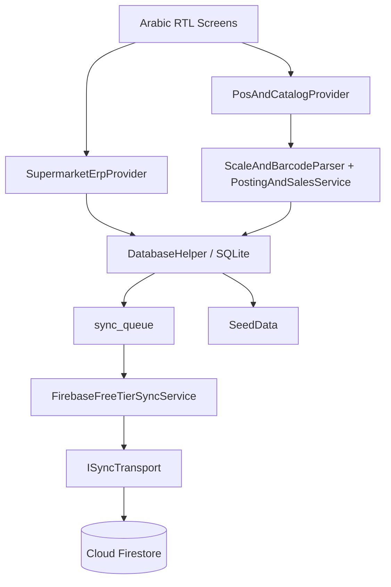
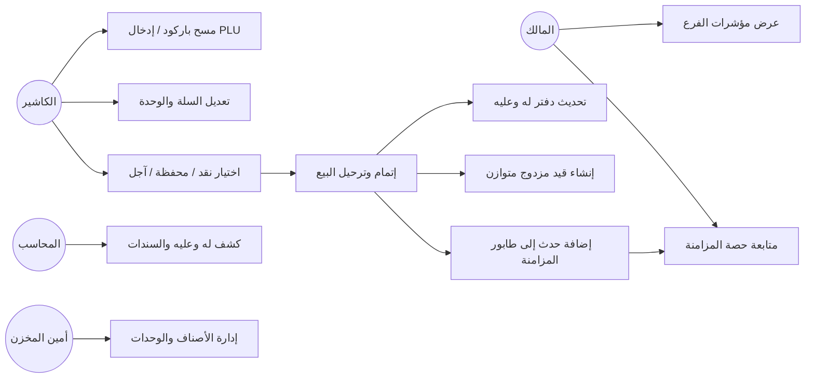
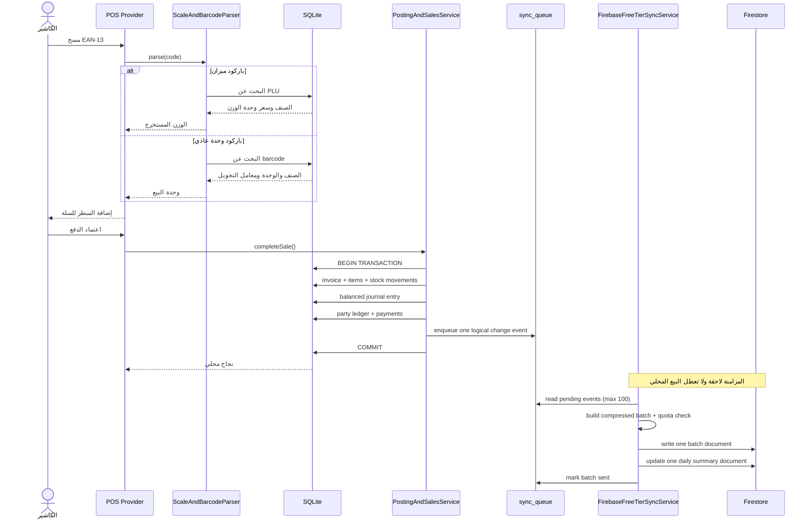
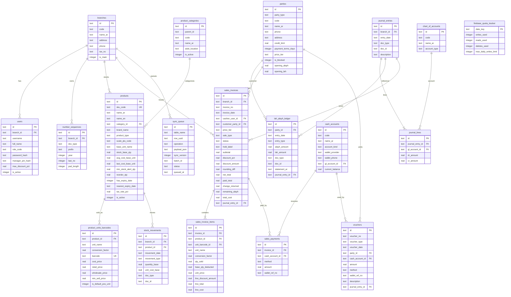

# Global Enterprise Supermarket & Retail ERP
## Iteration 1 — Supermarket ERP Core, Multi-Unit & Scale Barcode POS

**النمط:** Offline-First + Firebase Spark Sync  
**النطاق:** بيع مباشر داخل الفرع فقط؛ لا يوجد متجر إلكتروني أو سلة تسوق عبر الإنترنت.

## 1. قرارات التصميم
- SQLite هو مصدر الحقيقة التشغيلي محلياً؛ البيع لا ينتظر الشبكة ولا ينفذ أي قراءة من Firebase.
- كل عملية بيع تُرحّل داخل معاملة SQLite واحدة تشمل الفاتورة والبنود والمخزون والقيد ودفتر «له وعليه» والمدفوعات وطابور المزامنة.
- الكميات المخزنية تحفظ بوحدة الأساس؛ الكمية المخصومة = الكمية المباعة × معامل التحويل.
- القيود المحاسبية مزدوجة ومتوازنة في الخلفية. لا تعرض الواجهة مصطلحي «مدين» أو «دائن».
- المصدر الوحيد لرصيد الطرف الظاهر هو `lah_alayh_ledger`، ويعرض عبر `PartyBalanceChip`.
- كل شاشة وخدمة ومجموعة نماذج ومزود حالة في ملف مستقل.
- كل عملية مزامنة لها معرف ثابت لمنع تكرار أثرها عند إعادة المحاولة.
- أي حد للحصة أو سعر خطة Firebase يجب التحقق منه مقابل صفحة التسعير الرسمية قبل الإطلاق؛ الأرقام هنا افتراضات تصميمية واردة في متطلبات المشروع وليست ضماناً تعاقدياً.

## 2. الطبقات والمجلدات
```text
lib/
  main.dart
  core/theme/enterprise_dark_theme.dart
  core/widgets/shared_widgets.dart
  data/models/product_and_unit_models.dart
  data/models/erp_and_sync_models.dart
  data/database/schema_builder.dart
  data/database/seed_data.dart
  data/database/database_helper.dart
  data/services/scale_and_pos_service.dart
  data/services/firebase_free_tier_sync_service.dart
  providers/supermarket_erp_provider.dart
  providers/pos_and_catalog_provider.dart
  screens/app_shell.dart
  screens/dashboard/s02_executive_dashboard_screen.dart
  screens/pos/s03_supermarket_pos_screen.dart
  screens/catalog/s08_products_multi_unit_screen.dart
  screens/accounts/s19_parties_and_vouchers_screen.dart
docs/
  ITERATION_01_ARCHITECTURE.md
firestore.rules
DEVELOPMENT_LOG.md
```

## 3. مخطط المكونات


## 4. مخطط حالات الاستخدام


## 5. مخطط تتابع مسح الباركود والبيع والمزامنة


## 6. مخطط ERD


## 7. مخطط دفتر «له وعليه»
- `alayh_amount` و`lah_amount` موجبان حصراً في جهة واحدة لكل حركة؛ يطبق قيد تحقق يمنع تعبئة الجهتين معاً.
- الرصيد = مجموع «عليه» ناقص مجموع «له» من جدول `lah_alayh_ledger` حصراً؛ تُرحّل الأرصدة الافتتاحية إلى هذا الدفتر ولا تُقرأ مباشرة من جدول الأطراف.
- إذا كان الصافي موجباً تظهر «المتبقي عليه X» بالأحمر؛ وإذا كان سالباً تظهر «المتبقي له X» بالأخضر؛ وإذا صفراً تظهر «مسدَّد».
- لا تعرض الشاشات كلمات «مدين» أو «دائن». القيد المزدوج محصور في طبقة المحاسبة.

## 8. تعدد الوحدات وباركود الميزان
- كل وحدة بيع لها باركود ومعامل تحويل وسعر تجزئة وجملة وحد أدنى للبيع.
- المخزون يقاس بوحدة الأساس: `base_qty_deducted = qty_sold * conversion_factor`.
- EAN-13 يتحقق من 13 رقماً ومن رقم التحقق.
- تنسيق الميزان قابل للضبط حسب بادئة الميزان ومواقع PLU والوزن/السعر. المثال `20PPPPWWWWWC` إعداد افتراضي للاختبار وليس معياراً عالمياً. يجب أن تتوافق عينة `2010250125009` مع إعدادات الطول ورقم التحقق؛ لا تُقبل لمجرد مطابقة البادئة.

## 9. Firebase Spark: بنية المزامنة المقترحة
### مجموعات Firestore
```text
sync_batches/{branchId}/batches/{batchId}
  branchId, batchId, createdAt, schemaVersion, eventCount, compressedPayload, checksum
daily_summaries/{branchId}_{YYYYMMDD}
  branchId, dateKey, salesCount, salesTotal, cashTotal, walletTotal,
  creditTotal, stockAlertsCount, updatedAt, sourceBatchId
master_catalog/{branchId}_{catalogVersion}
  branchId, catalogVersion, productsAndUnits, updatedAt
```

- دفعة واحدة تضم حتى 100 حدث منطقي؛ يجب أن تبقى الوثيقة ضمن حد حجم المستند المسموح في Firestore. إذا تجاوزت الحمولة الحد، تقسم إلى دفعتين أصغر.
- يفضل ضغط JSON قبل الإرسال مع الاحتفاظ بإصدار مخطط وchecksum. الضغط يقلل الحجم المنقول لكنه لا يغير عدد عمليات الكتابة.
- كتابة batch واحدة ثم كتابة ملخص يومي واحدة تعني عمليتي كتابة لكل دفعة، لا عملية واحدة إجمالاً. لا يُحدّث الملخص إلا عند تغيره وبسياسة تجميع مناسبة.
- قراءة المالك للملخص اليومي يمكن أن تكون قراءة مستند واحد عند فتح لوحة المالك؛ تجنب listeners المستمرة أو الاستعلامات غير الضرورية.
- `master_catalog` ينشر عند تغير الكتالوج فقط، لا مع كل فاتورة.
- `ISyncTransport` يعزل Firestore عن مزود الحالة والخدمات؛ ويمكن إضافة ناقل خادم خاص أو خطة مدفوعة لاحقاً دون تعديل الشاشات.

### قواعد أمان أولية — firestore.rules
هذه نقطة انطلاق يجب اختبارها وربطها بنموذج هوية وصلاحيات حقيقي قبل الإنتاج:
```javascript
rules_version = '2';
service cloud.firestore {
  match /databases/{database}/documents {
    function signedIn() { return request.auth != null; }
    function sameBranch(branchId) {
      return signedIn() && request.auth.token.branch_id == branchId;
    }
    match /sync_batches/{branchId}/batches/{batchId} {
      allow read: if sameBranch(branchId);
      allow create: if sameBranch(branchId)
        && request.resource.data.branchId == branchId
        && request.resource.data.eventCount <= 100;
      allow update: if sameBranch(branchId)
        && resource.data.batchId == request.resource.data.batchId
        && resource.data.checksum == request.resource.data.checksum
        && resource.data.compressedPayload == request.resource.data.compressedPayload;
      allow delete: if false;
    }
    match /daily_summaries/{summaryId} {
      allow read: if signedIn()
        && request.auth.token.role in ['OWNER', 'MANAGER']
        && request.auth.token.branch_id == resource.data.branchId;
      allow create, update: if signedIn()
        && request.auth.token.role in ['OWNER', 'MANAGER']
        && request.auth.token.branch_id == request.resource.data.branchId;
      allow delete: if false;
    }
    match /master_catalog/{catalogId} {
      allow read: if signedIn();
      allow create, update: if signedIn()
        && request.auth.token.role in ['OWNER', 'MANAGER']
        && request.auth.token.branch_id == request.resource.data.branchId;
      allow delete: if false;
    }
  }
}
```
تسمح القواعد بتحديث الملخص والكتالوج فقط لحسابات OWNER أو MANAGER ذات Custom Claims صحيحة للفرع. إذا تقرر منع الكتابة المباشرة من تطبيق العميل، فيلزم ناقل موثوق أو خادم خارجي محدود الصلاحيات. لا تفترض توفر Cloud Functions في Spark، وأعد تقييم التكلفة والأمان قبل اختيار هذا المسار. لا تضع مفاتيح حساب خدمة في تطبيق الهاتف.

### مراقبة الحصة
- سجل تقدير عمليات القراءة والكتابة والحذف في `firebase_quota_tracker`.
- سقف أمان تطبيقي مقترح 18,000 كتابة يومياً مقابل حد 20,000 الوارد في مواصفات المشروع؛ يجب التحقق من الحصص الفعلية الحالية للمنطقة والخطة.
- كل دفعة تستهلك كتابة مستند الدفعة، وتحديث الملخص يستهلك كتابة إضافية. إعادة المحاولة يجب أن تكون idempotent وألا تعيد احتساب العملية قبل تأكيد النتيجة.
- لا يمكن اعتبار كتابة batch واحدة بديلاً مضموناً عن قواعد تكلفة Firestore: الكتابات داخل المستند الواحد تظل عملية مستند واحدة، لكن حجم المستند وحدوده ومعدل التحديث والتعارض يجب مراقبتها.
- عند بلوغ السقف، تبقى الأحداث محلياً في الطابور وتؤجل المزامنة حتى نافذة اليوم التالية.

## 10. قواعد البيع الذري
داخل معاملة SQLite واحدة:
1. التحقق من الأصناف والوحدات والأسعار والخصم وصلاحية الكاشير.
2. فحص حد الائتمان عند البيع الآجل.
3. التحقق من رقم إشعار المحفظة عند الدفع بالمحفظة.
4. توليد رقم الفاتورة بقفل/تحديث آمن للتسلسل.
5. إدخال رأس الفاتورة والبنود وحركات المخزون بوحدة الأساس.
6. إنشاء قيد محاسبي متوازن والتحقق من تساوي الإجمالي.
7. ترحيل أثر العميل إلى دفتر «له وعليه».
8. إدخال الدفعات والباقي للزبون.
9. إدخال حدث واحد أو أكثر إلى `sync_queue`.
10. COMMIT؛ وأي خطأ يؤدي إلى ROLLBACK كامل.

## 11. بيانات البذر
تتضمن الخطة فرعاً رئيسياً، وحساب مالك تجريبياً، ودليل حسابات، وصندوقاً ومحافظ جوالي وجيب وفلوسك وكريمي، وعميلَي اختبار وموردَين، وثمانية أصناف تجريبية متعددة الوحدات. بيانات الدخول الافتراضية المذكورة في المتطلبات مخصصة للتطوير المحلي فقط؛ يجب فرض تغييرها وعدم استخدامها في الإنتاج، وتخزين كلمات المرور كـ hash آمن لا كنص صريح.

## 12. أوامر Git للدورة الأولى
بعد اكتمال التنفيذ والاختبارات الفعلية:
```bash
git status
git add docs lib firestore.rules DEVELOPMENT_LOG.md
git commit -m "feat: implement supermarket ERP iteration 1 core"
flutter pub get
dart format .
flutter analyze
flutter test
flutter build apk --debug
git tag -a v0.1.0-iter1 -m "Supermarket ERP Iteration 1"
git push origin main
git push origin v0.1.0-iter1
```
لا تنشئ الوسم قبل اجتياز بوابات التحقق فعلياً. سجل أوامر الفحص ونتائجها في `DEVELOPMENT_LOG.md`.

## 13. حدود هذه الوثيقة
هذه الوثيقة تصف التصميم المستهدف. لا تعني أن جميع الشاشات أو الخدمات أو Firebase أو الاختبارات قد نُفذت. لا تُعلن أي نتيجة بناء أو اختبار إلا بعد تشغيل الأمر وتسجيل مخرجاته.
