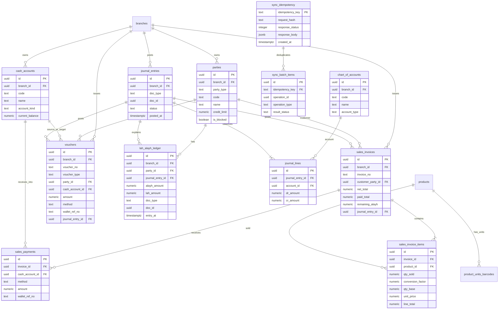
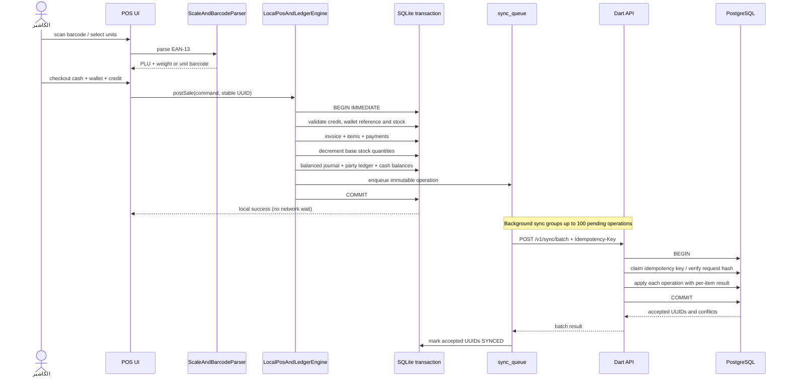
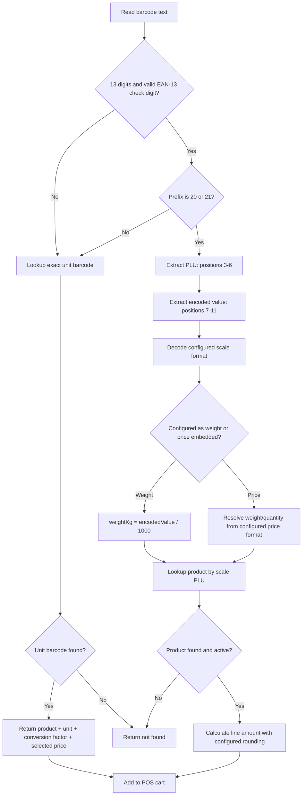

# Iteration 2 — Full-Stack POS, Lah/Alayh Ledger, Vouchers, Batch Sync and Official Printing

**النظام:** Global Enterprise Supermarket & Retail ERP  
**الحالة:** Architecture baseline and implementation contract  
**الفرع:** `feature/official-pdf-report-template`

## 1. نطاق الدورة الثانية

تضيف هذه الدورة مسارات البيع والسندات والدفتر المالي المبسط للأطراف والمزامنة المجمعة والطباعة الحرارية والرسمية، مع المحافظة على دورة SQLite المحلية الموجودة في الدورة الأولى.

### 1.1 حقائق المستودع عند بدء الدورة

- تطبيق Flutter الحالي موجود في جذر المستودع تحت `lib/`، وليس تحت `app/`.
- مخطط SQLite الحالي منشأ بواسطة `lib/data/database/schema_builder.dart` ويحتوي بالفعل على جداول الأصناف والوحدات والأطراف والدفتر والقيود والصناديق والفواتير والمدفوعات وطابور المزامنة.
- خدمة POS الحالية: `lib/data/services/scale_and_pos_service.dart`.
- قالب PDF الرسمي الحالي: `lib/core/pdf/official_report_template.dart`.
- توجد شاشات POS والأطراف ولوحة التحكم ومزودات الحالة في `lib/`.
- لا توجد عند بدء هذه الدورة مجلدات `server/` أو `packages/core_contracts/` أو `packages/api_client/`، ولا يوجد عقد OpenAPI أو سجل تغييرات مستقل. تُنشأ هذه الأجزاء تدريجيًا ولا تُعامل كأنها موجودة أو منشورة قبل تنفيذها واختبارها.
- النقل السحابي الموجود في الدورة الأولى مبني على Firebase/Firestore. إضافة Dart HTTP API وPostgreSQL تعني إضافة مسار نقل جديد، ولا تعني حذف Firebase أو تحويله تلقائيًا.

## 2. المبادئ المعمارية الملزمة

1. **Offline-first:** لا تنتظر عملية البيع الشبكة. التحقق والحفظ المحلي وتحديث المخزون والدفتر والصندوق وطابور المزامنة تتم داخل معاملة SQLite واحدة.
2. **مصدر الرصيد الوحيد:** دفتر `lah_alayh_ledger` هو مصدر رصيد الطرف الظاهر. لا تجمع أرصدة الطرف من القيود العامة أو من الفواتير مباشرة.
3. **دفتر مبسط:** تستخدم واجهة المستخدم وDTOs العامة فقط `ALAYH`, `LAH`, `ZERO`، مع عبارات «المتبقي عليه»، «المتبقي له»، «مسدَّد». لا تعرض الواجهة أو تقارير الأطراف أسماء جانبي القيد المحاسبي الداخليين.
4. **قيد مزدوج داخلي:** تحتفظ قاعدة البيانات بقيود محاسبية متوازنة. لا تكفي قيود `CHECK` على صف منفرد لضمان توازن مجموعة أسطر؛ يجب فرض التوازن عند اعتماد القيد، باستخدام deferred constraint trigger في PostgreSQL والتحقق داخل معاملة SQLite.
5. **Idempotency:** لكل أمر مالي UUID ثابت ومفتاح `Idempotency-Key` ثابت عبر جميع محاولات الإرسال. تخزن الخوادم نتيجة المفتاح وتعيد النتيجة نفسها عند إعادة الطلب، ولا تعيد تنفيذ الأثر المالي.
6. **عدم الادعاء:** وجود العقد أو Migration لا يعني أن الخادم يعمل. تُحدّث حالة التنفيذ بعد نجاح الاختبارات الفعلية فقط.
7. **المال:** تستخدم PostgreSQL نوع `NUMERIC` لا `REAL` للمبالغ. ويجب تحديد دقة العملة وسياسة التقريب في إعدادات الفرع.
8. **الوقت:** تُخزن الأوقات في UTC في الخادم، وتُعرض وفق المنطقة الزمنية للفرع.

## 3. بنية الطبقات المستهدفة

### تطبيق Flutter (المسار الحالي)

```text
lib/
  core/
    pdf/
      official_report_template.dart
      receipt_and_ledger_pdf_builder.dart
    widgets/
      shared_widgets.dart
  data/
    database/
      schema_builder.dart
      migrations/
    models/
      erp_and_sync_models.dart
      product_and_unit_models.dart
    services/
      scale_and_pos_service.dart
      scale_pos_and_ledger_service.dart
      firebase_free_tier_sync_service.dart
      i_sync_transport.dart
  providers/
    pos_and_ledger_provider.dart
  screens/
    pos/s03_supermarket_pos_screen.dart
    accounts/s19_parties_and_vouchers_screen.dart
    dashboard/s02_executive_dashboard_screen.dart
```

### Dart server وواجهات العقود (مجلدات جديدة)

```text
server/
  bin/server.dart
  migrations/
  lib/features/
    ledger/{domain,application,data,presentation}/
    sales_and_sync/{domain,application,data,presentation}/
  test/
packages/
  core_contracts/lib/core_contracts.dart
  api_client/lib/api_client.dart
```

داخل كل ميزة خادمية:
- `domain`: كيانات وقواعد أعمال لا تعتمد على HTTP أو PostgreSQL.
- `application`: حالات الاستخدام وحدود المعاملات.
- `data`: مستودعات PostgreSQL ومحوّلات التخزين.
- `presentation`: DTO mapping والتحقق من HTTP والتوجيه ومعالجة الأخطاء.

## 4. قواعد دفتر «له وعليه»

لكل طرف:
- `totalAlayh = SUM(alayh_amount)`
- `totalLah = SUM(lah_amount)`
- `net = totalAlayh - totalLah`
- إذا `net > 0`: `balanceSide = ALAYH` و`balanceAbs = net`.
- إذا `net < 0`: `balanceSide = LAH` و`balanceAbs = abs(net)`.
- إذا `net = 0`: `balanceSide = ZERO` و`balanceAbs = 0`.

يجب أن يكون كل سطر دفتر حركة واحدة فقط: مبلغ موجب في حقل واحد وصفر في الآخر. القيد الافتتاحي يُسجل بحركة افتتاحية واضحة ولا يكرر جمعه مرة أخرى من حقول افتتاحية قديمة.

## 5. ERD — PostgreSQL



ملاحظة: ERD يوضح الكيانات والعلاقات المطلوبة. Migration الفعلية يجب أن تطابق أسماء وقيود الجداول الموجودة في Migration الأولى عند إنشائها، وأن تستخدم مفاتيح أجنبية فعلية لا مجرد أسماء موضحة هنا.

## 6. Sequence — البيع المحلي ثم المزامنة



يجب أن تضمن معاملة الخادم عدم تطبيق العملية نفسها مرتين حتى لو وصل الطلب عشر مرات. مفتاح الطلب العام يحمي الدفعة، ومعرف كل عملية يحمي كل فاتورة أو سند داخل الدفعة. لا تُسجل الدفعة على أنها ناجحة بالكامل إذا احتوت عناصر مرفوضة؛ تعاد نتيجة مستقلة لكل عنصر.

## 7. Flowchart — Scale EAN-13 and multi-unit parser



### 7.1 تنسيق باركود الميزان

- لا يكفي افتراض أن كل بادئة `20` أو `21` تعني وزنًا؛ يجب أن يكون تنسيق الميزان قابلًا للتهيئة لكل فرع/ميزان.
- التنسيق المذكور `20PPPPWWWWWC`: بادئة من رقمين، PLU من أربعة أرقام، قيمة من خمسة أرقام، ثم رقم تحقق EAN-13.
- المثال `2010250150003` يفسر PLU=`1025` وقيمة الوزن=`01500` أي 1.500 كجم عند ضبط معامل 1000.
- يجب التحقق من رقم EAN-13 قبل قبول الرمز. يُرفض الرمز إذا لم يتطابق رقم التحقق أو لم يوجد PLU.
- إذا كان ترميز الميزان مبلغًا لا وزنًا، فلا يجوز تفسيره كوزن؛ يحدد ذلك إعداد صيغة الميزان.

## 8. قواعد البيع والدفع

1. التحقق من توفر المخزون ومن كون المنتج والوحدة نشطين.
2. حساب `qty_base = qty_sold * conversion_factor` بدقة مناسبة، ثم خصم `qty_base` من `stock_base_qty`.
3. النقد والمحافظ تُسجل كدفعات مرتبطة بحساب نقدي. رقم إشعار المحفظة إلزامي وبحد أدنى 6 خانات بعد إزالة المسافات.
4. الدفع الآجل أو المختلط يتطلب عميلًا صالحًا وغير محظور. يحسب الرصيد المتوقع بعد العملية قبل الحفظ ويقارن مع `credit_limit` وفق سياسة تجاوز حد الائتمان المعتمدة.
5. لا يمكن أن يتجاوز مجموع الدفعات صافي الفاتورة إلا إذا عُرّف صراحةً مبلغ الباقي للزبون. يُفصل `change_returned` عن قيمة الدفعات الفعلية.
6. يُسجل الجزء المتبقي للعميل في `lah_alayh_ledger.alayh_amount`.
7. لا تحفظ الفاتورة إلا مع القيد الداخلي المتوازن وجميع تحديثات المخزون والصندوق والدفتر وطابور المزامنة داخل معاملة محلية واحدة.

## 9. السندات

- سند القبض من عميل: يزيد حساب النقد/المحفظة ويضيف حركة `lah_amount` للعميل.
- سند الصرف لمورد: ينقص حساب النقد/المحفظة ويضيف حركة `alayh_amount` للمورد.
- التسوية يجب أن تحدد نوع الطرف واتجاه الأثر بوضوح، ولا يجوز استنتاج اتجاهها من اسم الزر وحده.
- كل سند ينشئ قيدًا داخليًا متوازنًا وحركة دفتر واحدة ومعاملة نقدية واحدة وطابور مزامنة واحدًا.
- يمنع الصرف إذا كان رصيد الحساب النقدي غير كافٍ، إلا إذا سمحت سياسة الفرع بالسحب على المكشوف.

## 10. Batch Sync وIdempotency

- الحد الأقصى للدفعة: 100 عملية.
- الطلب يحمل `Idempotency-Key` غير فارغ ومفتاحًا ثابتًا عند إعادة المحاولة.
- يحتفظ الخادم ببصمة canonical request hash. إعادة المفتاح مع نفس البصمة تعيد الاستجابة المخزنة؛ وإعادة المفتاح مع محتوى مختلف تعيد `409 IDEMPOTENCY_KEY_REUSED`.
- لكل عنصر `operationId` UUID ثابت وفريد، ويمنع تكرار الأثر حتى لو ظهر في دفعات مختلفة.
- تُعالج الدفعة في معاملة PostgreSQL واحدة. سياسة الفشل الافتراضية ذرية للدفعة: أي خطأ مالي يرفض الدفعة كلها. إذا تقرر اعتماد نتائج جزئية لاحقًا، يجب أن تكون كل عملية داخل savepoint وتوثق السياسة في API.
- استجابة المزامنة تعرض `acceptedIds`, `rejected`, `serverTime` و`batchId`.
- لا تُرسل أسرار أو بيانات دفع حساسة في سجل التطبيق. تُخزن أرقام الإشعارات وفق سياسة حماية البيانات.

## 11. OfficialReportTemplate والطباعة

- التقارير الرسمية A4 تستدعي `OfficialReportTemplate.preview` الموجود في الدورة الأولى، ولا تنشئ قالبًا موازيًا.
- كشف الطرف يعرض بطاقات إجمالي ما عليه، إجمالي ما له، وصافي المتبقي، ثم الحركات مرتبة زمنيًا.
- أعمدة العرض: `م | التاريخ | البيان | المستند | عليه | له | المتبقي` باتجاه RTL.
- إيصال POS يدعم 80mm و58mm، ويشمل اسم المتجر ورقم الفاتورة والوقت والأصناف والوحدات والكميات والأسعار والإجمالي والمدفوع والباقي/المتبقي عليه ومرجع الباركود.
- تُختبر معاينة PDF والطباعة الفعلية على Android وWindows والويب. لا يفترض أن كل طابعة حرارية تدعم طباعة الويب المباشرة؛ قد يتطلب Web print حوار المتصفح.

## 12. الأمان والاتساق

- كل endpoint محمي بمصادقة وهوية فرع وصلاحيات role-based. لا يقبل الخادم `branch_id` المرسل دون مطابقته مع هوية الجلسة.
- معاملات PostgreSQL تستخدم isolation مناسبًا وتُقفل صفوف المخزون والحسابات النقدية عند التعديل.
- جميع المبالغ `NUMERIC(20,4)` افتراضيًا حتى تحديد دقة العملة.
- يجب فرض فهرس فريد على `(branch_id, operation_uuid)` و`idempotency_key`.
- لا يُعتمد قيد يومية قبل التحقق المؤجل من تساوي إجمالي طرفيه.
- لا يسمح بحذف أثر مالي معتمد؛ التصحيح يتم بقيد عكسي/مستند عكسي.

## 13. ترتيب التنفيذ والقبول

1. تثبيت عقود DTO وOpenAPI وMigration دون تغيير مخطط الدورة الأولى.
2. اختبارات SQL للقيود والتوازن والعرض `v_party_balance`.
3. تنفيذ المستودعات وحالات استخدام الأطراف والسندات.
4. تنفيذ المبيعات والمزامنة المجمعة مع اختبار التكرار.
5. توصيل محرك Flutter المحلي بمخطط SQLite والترحيلات.
6. توصيل Provider والشاشات والتقارير والإيصالات.
7. تشغيل `flutter analyze`, `flutter test`, واختبارات الخادم وPostgreSQL فعلية.
8. بناء Android Release وWindows Release وWeb Release.

### معايير القبول

- البيع المحلي لا يعتمد على توفر الشبكة.
- كل فاتورة وسند ينتج عنهما قيد داخلي متوازن.
- كل سطر دفتر يحتوي مبلغًا موجبًا في جانب واحد فقط.
- رصيد الطرف في API وUI وPDF مشتق من `lah_alayh_ledger` فقط.
- تكرار `Idempotency-Key` و`operationId` لا يكرر الأثر.
- اختبار الباركود `2010250150003` ينتج PLU `1025` ووزن `1.500 kg` بعد التحقق من رقم EAN-13.
- بيع وحدة معاملها 24 يخصم 24 من مخزون وحدة الأساس.
- جميع الأزرار الأساسية لها مسار محفوظ/مطبوع/مزامن ومغطى باختبار.
- لا تُعلن أي منصة ناجحة إلا بعد مشاهدة نتيجة البناء الفعلية.
